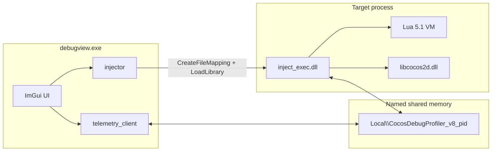

# Cocos2d DebugView

针对 **Windows 32 位、Cocos2d-x + Lua 5.1** 进程的外部调试与性能分析工具。

DebugView 作为独立窗口运行：扫描目标进程中的 Lua VM 和 Cocos2d 导出，注入采集 DLL，再通过共享内存把逐帧数据拉回本机 UI。运行期间不在游戏场景里创建显示节点，也不把逐帧数据写到磁盘（主动保存录制除外）。

适用目标大致是：带可见主窗口、加载了 `libcocos2d.dll` 和 Lua 5.1 的 32 位进程。不同游戏的 dump 与录制互不绑定。

## 能力概览

- 实时曲线：DrawScene Body、帧间隔 DeltaTime、Renderer submit、Lua wall / CPU / self
- 逐帧 Lua 方法表（self / inclusive / 调用次数）和可选 C++ hook 样本
- 可选 Lua 行热点（COUNT 采样）和原始 CALL/RET 事件流
- 远程执行 Lua（编辑器或 DebugList 片段），支持全局热键
- 把目标进程 `loadbuffer` / `loadfile` 到的 chunk 转储到 `luac_dump/<进程名>/`
- 保存 / 加载 `.cocosdbg` 录制（含可选窗口预览图）

## 架构



两端通过 `Local\CocosDebugProfiler_v8_<pid>` 通信。协议定义在 [`common/profiler_ipc.h`](common/profiler_ipc.h)：双向命令、心跳、方法字典、256 帧 seqlock 环、可开关的 Lua 事件环。

注入后的主循环挂在目标窗口过程上，以 `Director::drawScene` 为帧边界；远程 Lua 不在 C++ hook 里直接 `pcall`，而是由 Cocos Scheduler 在安全 Lua 上下文中 drain。

## 目录

| 路径 | 作用 |
|------|------|
| [`common/`](common/) | IPC 共享内存布局（viewer 与 DLL 共用） |
| [`injection/`](injection/) | 进程扫描、注入、目标进程内 profiler |
| [`injection/scripts/`](injection/scripts/) | 嵌入的 bootstrap / coroutine 发现脚本 |
| [`debugview/`](debugview/) | Win32 + Dear ImGui + ImPlot 界面 |
| [`tests/`](tests/) | IPC、profiler 内核、Lua 5.1、录制格式测试 |
| [`third_party/imgui`](third_party/imgui)、[`third_party/implot`](third_party/implot) | UI 依赖 |
| [`build.bat`](build.bat) | 32 位 MinGW 构建入口 |

构建产物（已在 `.gitignore`）：

| 路径 | 作用 |
|------|------|
| `build/debugview.exe` | 主程序 |
| `build/debug_list/` | 本地 Lua 片段与 `index.txt` |
| `build/luac_dump/<进程名>/` | 该进程的 Lua chunk 转储 |
| `build/generated/` | 嵌入头文件、测试 exe、ImGui 对象缓存 |

## 构建

依赖：

- 32 位 MinGW（`gcc` / `g++`）
- 与本仓库并列的 Lua 5.1.4 头文件与源码：`../Lua_5_1_4/src`
- PowerShell（嵌入 bootstrap / DLL、编译 ImGui 缓存）

```bat
build.bat
```

会依次：嵌入 Lua bootstrap → 编注入 DLL 并再嵌入 → 编 injector → 跑测试 → 链接 `build/debugview.exe`。

ImGui/ImPlot 编成 `build\generated\imgui_obj\*.o`，按时间戳复用。本机旧 MinGW 没有 DirectX 11 SDK，界面使用官方 Win32 + DirectX 9 后端；这只影响 DebugView 自己的窗口，与目标进程渲染 API 无关。

若 `debugview.exe` 正在运行导致链接失败，会改写 `build\debugview_new.exe`。

可选：对**正在运行**的目标进程做 Body 分布 A/B（先注入过的 PID）：

```bat
build.bat ab
build\generated\runtime_ab_test.exe <pid>
```

看 baseline / Lua-C-mixed / coroutines 的 Body、Lua wall、C self。不要只凭代码直觉判断 hook 开销。

## 使用

1. 启动目标 Cocos2d 进程，再启动 `build/debugview.exe`。
2. 在 Target 下拉框选择进程（列表只包含有可见主窗口的进程），点 **Inject and connect**。
3. 点 **Start profiling** 开始采集。连接时会跳过 IPC 环里上一轮残留帧。
4. 在曲线上单击一帧，查看该帧 Lua 方法表、C++ hook、可选行热点 / 原始事件。
5. **Stop** 只关掉高开销 Lua hook；DLL 仍驻留，之后可以再次 Start。
6. **Run Lua String** 向目标 Lua 状态投递一段脚本；**DebugList** 管理可保存、可热键的片段。
7. **Save now** / **Load recording** 读写 `.cocosdbg`。Stop 时若有缓冲帧，会自动保存一份时间戳文件。

### 界面要点

- **Follow target window**：DebugView 吸附在目标窗口右侧。
- **Pause view**：冻结曲线与选中帧，不影响目标侧是否仍在采集。
- **Capture Lua details**：临时打开 VM COUNT 采样，用于行热点。
- **Trace Start / Stop**：打开/关闭原始 Lua 事件环（开销明显高于聚合表）。
- **Spike hints**：按设定的 Body 预算标出慢帧。
- DebugList 热键是全局的：即使 DebugView 不在前台也会触发；Windows 会吃掉该组合，目标进程收不到。

### 注入与二次注入

C++ 采集目标在 [`injection/injector.c`](injection/injector.c) 的 `resolve_cpp_hooks()` 里：

- 必选：`cc.Director:drawScene`（帧边界）
- 常见 submit：`cc.Renderer:render`
- 可选：`cc.Scene:render`（解析到才安装）

符号先在 `libcocos2d.dll` 里找，再回退到目标主可执行模块。不要 hook `Node::visit` 这类极高频方法。

如果提示目标进程里已经有 profiler DLL，必须先**重启该进程**再注入，不要二次注入。

## 指标含义

Lua 统计窗口严格限定为 `Director::drawScene` 原函数体。CALL / RET / TAILRET 按每个 `lua_State` 独立调用栈记账；`lua_resume` 的进入和返回用来扣掉协程 yield 后的等待。跨帧调用不切栈，只按当前 drawScene 窗口裁剪。

| 名称 | 含义 |
|------|------|
| DrawScene / Body | 这一次 `drawScene` 函数体耗时 |
| DeltaTime | 这次 `drawScene` 开始到下一次开始：body + present / vsync / idle。有 vsync 时会贴在 16.67/33ms；Body 变慢出现在**同一帧**的 DeltaTime 上 |
| render | `cc.Renderer:render` 的 submit。没解析到符号显示 not installed；解析到但 0 次调用说明 export 不在提交路径上 |
| Lua wall | 所有 Lua 线程执行区间的并集，表示它们占了多少墙钟 |
| Lua CPU | 各 Lua 线程执行时间之和；并行时可以大于 wall |
| Lua self | Lua / main 函数独占时间 |
| C self | 从 Lua 调到的 C 函数独占时间 |
| inclusive | 含同一 `lua_State` 的嵌套调用 |
| self（方法表） | 不含子调用 |
| 行热点 | 每 4000 条 VM 指令一次 COUNT 采样，只是样本数和占比，不是精确毫秒 |

协议里 `lua_frame_index` 与 `render_frame_sequence` 分开传输，不要假定严格一一对应。

## 通信协议

定义：[`common/profiler_ipc.h`](common/profiler_ipc.h)

| 项 | 值 |
|----|----|
| 映射名 | `Local\CocosDebugProfiler_v8_<pid>` |
| magic | `0x42444343`（`CCDB`） |
| 版本 | 8 |

Viewer 先 `CreateFileMapping` 并写入注入配置（Lua state、drawScene 地址、bootstrap 脚本、dump 目录等），再把 DLL 写到 `%TEMP%\cocos_debug_profiler_<pid>_<tick>.dll` 后 `LoadLibrary`。DLL 打开同一映射，安装 hook，把帧写入环形缓冲。

常用命令：`START` / `STOP` / `CLEAR` / `DETAIL_CAPTURE` / `RUN_LUA` / `TRACE_START` / `TRACE_STOP` / `SHUTDOWN`。Viewer 掉线时，正在录制的 DLL 会自行 STOP。

magic 或版本不一致会直接拒绝连接，不读旧协议。

## 持久化格式

### 录制 `.cocosdbg`

- magic：`CCDBREC1`（8 字节）
- 版本：5；升级后不读旧文件
- 默认文件名：`cocosdbg_capture_YYYYMMDD_HHMMSS.cocosdbg`
- 内容：帧快照（Lua 方法、C++ hook、行样本、可选 trace 事件）以及窗口预览图

读写实现：[`debugview/recording_io.cpp`](debugview/recording_io.cpp)

### DebugList

目录：`debugview.exe` 同目录下的 `debug_list\`。

- `index.txt` 首行：`CocosDebugList 2`
- 每行：`id<TAB>filename<TAB>hotkey<TAB>显示名`
- 每条脚本一个 `.lua` 文件

未注入时也可以编辑；**Run** 需要先 Inject and connect。

### Lua chunk 转储

注入成功后，hook `luaL_loadbuffer` / `luaL_loadfile`，把 chunk 写到：

```
<debugview.exe 目录>\luac_dump\<进程名>\
```

进程名由目标 exe 去掉扩展名并做路径安全化得到，例如 `sealapp.exe` → `luac_dump/sealapp/`。同时生成 `luac_dump_map.tsv`。profiler 自身的 bootstrap / 远程执行 chunk 会被跳过。

## 目标约束

- **仅 32 位** Windows 进程（构建与注入都是 `-m32`）
- 需要能解析 `cocos2d::Director::drawScene`（通常来自 `libcocos2d.dll`）
- Lua 5.1：扫描 `global_State` / `lua_State`，hook `lua_sethook`、`lua_resume`、`lua_newthread`
- 远程 Lua drain 依赖 `cc.Director:getInstance():getScheduler()`
- 列表里只出现有可见根窗口的进程；无窗口后台进程不会显示

换引擎、换 Lua 版本或把 Cocos 静态链进非标准模块时，需要改符号解析，而不是只改 UI。

## 测试

`build.bat` 默认会跑：

| 测试 | 覆盖 |
|------|------|
| `tests/ipc_selftest.c` | 共享内存映射、字典、帧 seqlock、事件、命令 |
| `tests/lua_profiler_core_test.c` | 调用栈、self/inclusive、协程裁剪 |
| `tests/lua_profiler_lua51_test.c` | 链入 Lua 5.1 源码的集成路径 |
| `tests/recording_io_test.cpp` | `.cocosdbg` 往返与旧版本拒绝 |

`tests/runtime_ab_test.c` 不进默认构建，需要 `build.bat ab` 且目标进程已在运行。

## 本地辅助工具

`build/` 下还有不参与正式构建的一次性扫描源码，需自行传入目标：

```bat
build\dump_lua_exports.exe <pid|process.exe>
build\find_undump.exe <pid|process.exe>
build\xref_undump.exe <pid|process.exe>
```

没有默认进程名。
